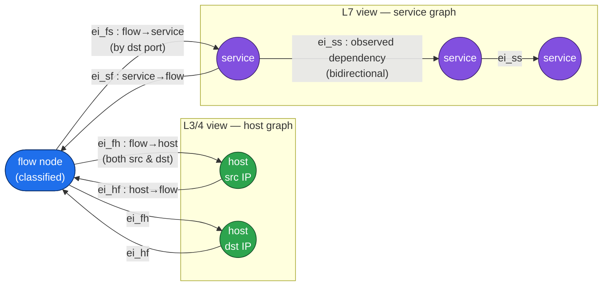
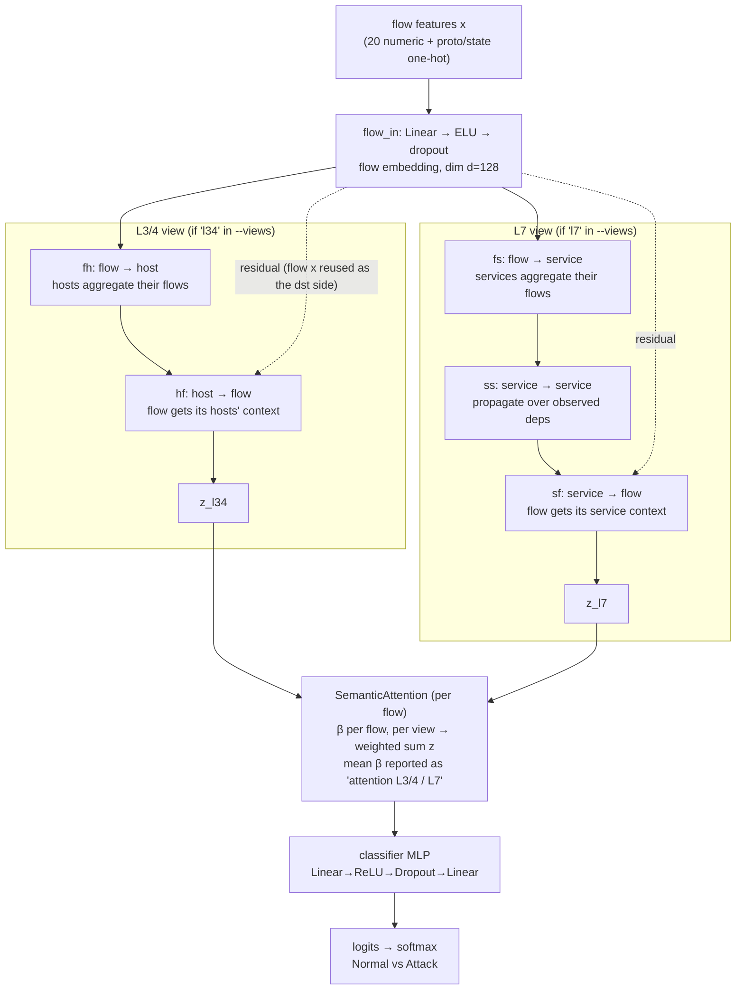

# The two-view heterogeneous graph in `two_view_hetero_gat.py`

Companion to [`l3-capture.md`](./l3-capture.md) (where the data comes from) and
[`attack-simulation.md`](./attack-simulation.md) (how a session is produced). This page
explains **the graph the model actually builds and passes messages over** in
[`ai-model/two_view_hetero_gat.py`](../../ai-model/two_view_hetero_gat.py) — the node
types, the edges, and how one forward pass turns a captured flow into an attack/normal
decision.

The model is a **heterogeneous Graph Attention Network (GATv2)**. "Two-view" = it looks
at every flow through two different graphs at once — an **L3/4 host view** and an **L7
service view** — then lets a small attention layer decide how much to trust each.

---

## 1. The three node types

| Node type | Count | What it is | Initial features (code) |
| --- | --- | --- | --- |
| **flow** | `N` (one per Argus record) | A single L3/4 flow from `netflows.csv` — the thing we classify | `x`: 20 numeric Argus counters (`log1p` + standardized) **+** one-hot `proto`/`state` → `flow_in` Linear to dim `d` |
| **host** | `n_hosts` (distinct src/dst IPs) | A pod / gateway / attacker IP | one **shared learned** `host_token`, broadcast to every host (`self.host_token.expand(...)`) |
| **service** | `n_svc` (14 here) | An Online Boutique microservice, from `observed_services.graphml` | a learned `nn.Embedding(n_svc, d)` (`self.svc_emb`) |

`d = hid * heads = 32 * 4 = 128` is the hidden width every node is projected to.

> **Why hosts start identical but services don't.** A host has no inherent identity worth
> memorizing (IPs churn every session), so all hosts share one learned token and get their
> meaning purely from the flows attached to them. A *service* is a stable, named entity
> (`cartservice`, `frontend`, …), so each gets its own embedding row.

---

## 2. The edges (the graph schema)

Every edge set is built in `build_tensors()` (lines 89–101) and `fs_edges()` (64–86).



| Edge set | Direction | Shape | Built from | Meaning |
| --- | --- | --- | --- | --- |
| `ei_fh` | flow → host | `[2, 2N]` | `src_h`, `dst_h` (factorized `saddr`/`daddr`) | each flow touches **two** hosts: its source and its destination IP |
| `ei_hf` | host → flow | `[2, 2N]` | `ei_fh[::-1]` | the reverse, so hosts send information back to flows |
| `ei_fs` | flow → service | `[2, N]`¹ | `fs_edges()` via dst port | each flow is attached to one service node (which one depends on `--mapping`) |
| `ei_sf` | service → flow | `[2, N]`¹ | `ei_fs[::-1]` | services send back to flows |
| `ei_ss` | service ↔ service | `[2, 2·E]` | `observed_services.graphml`, made bidirectional | the **real observed call graph** (14 services, ~19 deps) |

¹ For `--mapping random`, `ei_fs` is `[2, 2N]` (a flow links to *both* its hosts' services).

### How a flow picks its service node (`fs_edges`, the `--mapping` flag)

Captured Argus flows have **no service label**, so `l7_keys()` falls back to the
**destination port** as the L7 category. `fs_edges()` then maps categories → service nodes
three different ways — this is the experiment that tests *whether the L7 topology carries
real signal*:

- **`port`** (default) — categories are ranked by frequency, services by **degree** in the
  dependency graph, and the busiest ports are attached to the hub services. This is the
  "meaningful" alignment.
- **`shuffled`** — same grouping of flows, but categories attach to **random** service
  nodes. Keeps *which flows share a service* but **breaks** alignment with the real
  topology. **Control:** if `port` ≈ `shuffled`, the topology isn't adding information
  beyond the grouping.
- **`random`** — every host is assigned a random service; a flow links to its src and dst
  host's service. The weakest coupling, a second control.

---

## 3. One forward pass (how a decision is made)

`TwoViewGAT.forward()` (lines 216–229). Each arrow is a **`BiGAT`** layer — a bipartite
`GATv2Conv` with an ELU and a residual on the receiving side (lines 174–182).



Walking the two views:

- **L3/4 view** — `fh` lets each **host** gather the flows attached to it (so a host that
  is the target of a flood accumulates that evidence), then `hf` pushes that host context
  back onto each flow. A flow whose destination host is being hammered now "knows" it.
- **L7 view** — `fs` lets each **service** gather its flows; `ss` then propagates across
  the **observed dependency graph** (so pressure on `frontend` can inform `cartservice`);
  `sf` pushes service context back to the flow.
- **Fusion** — `SemanticAttention` scores each view's embedding **per flow** and takes a
  softmax over the views, so every flow gets its own pair **β = (β_L3/4, β_L7)**, summing to 1,
  and its fused vector is the β-weighted sum. The run prints the **mean β over the test flows**
  as `attention L3/4 0.xxx  L7 0.xxx`. (An earlier version averaged the scores over the whole
  graph and learned one global β, so every alert had identical weights. Results from before
  this change should be re-run.)
- **`--views`** selects which subgraphs run: `none` (flow MLP baseline, no graph), `l34`,
  `l7`, or `both`. With one view there's nothing to fuse, so β is `None`.

### Per-alert view attribution (`--explain DIR`)

```sh
.venv/bin/python two_view_hetero_gat.py --netflows session_<UTC>/dataset/netflows.csv \
    --graphml session_<UTC>/dataset/observed_services.graphml --explain session_<UTC>/explain
```

Needs `--views both` (the default) and doesn't work with `--sweep`. It uses the first seed and the
test split. `05_run_attacks.sh --train` passes it automatically. It writes:

| File | Shows |
| --- | --- |
| `explanations.csv` | every test flow: `saddr, daddr, dport, proto, state, label, y_true, p_attack, pred, is_alert, beta_l34, beta_l7, dominant_view` |
| `view_by_class.png` | L7 weight distribution of the alerts, per true attack label |
| `view_hist.png` | L7 weight histogram, alerts vs non-alerted flows |
| `top_alerts.png` | the 30 most confident alerts as L3/4 / L7 stacked bars |
| `p_vs_view.png` | model confidence vs L7 weight, colored by label |

**Read β as attention, not causality.** It shows how much each view's embedding is weighted in that
flow's fused vector, not how much the prediction would change without that view.
The plots need `matplotlib` (in `requirements-model.txt`). Without it, only the CSV is written.

---

## 4. Dimensions at a glance (this dataset)

| Symbol | Value | Source |
| --- | --- | --- |
| `N` flows | 96,241 | rows in `netflows.csv` |
| `n_hosts` | 51 | distinct `saddr`/`daddr` |
| `n_svc` | 14 | nodes in `observed_services.graphml` |
| dependency edges | 19 | edges in the graphml |
| `in_dim` | 20 numeric + one-hot(`proto`,`state`) | `fit_capture()` / `transform_capture()` |
| `d` (hidden) | 128 | `hid(32) × heads(4)` |
| split | separate sessions, or 60/20/20 | see below |

### The train / val / test split

Preferred: **three separate capture sessions** (`--netflows` train, `--val_netflows`,
`--test_netflows`), each class-complete. The featuriser (`fit_capture`) is fit on the
**training** session only — numeric log1p mean/std, the `proto`/`state` levels, the
dst-port→service mapping and the class list — and reused to transform val/test
(`transform_capture`), so there is no leakage. Each split is built into its **own graph**
(`build_tensors` per split), so the test flows never message-pass during training
(inductive). Hosts share one learned token, so new attacker/pod IPs in val/test need no
retraining; services are matched by name through the shared training `observed_services.graphml`.

Fallback: with a single `--netflows` and no val/test files, flows are sorted by `stime`
and cut **60/20/20 temporally** — train on the past, test on the future. This is honest in
time but, in one session, whichever attack classes land in the last 20% are the only ones
tested (and validation, which picks the best epoch, can miss classes too). The script warns
in that case. Validation always drives the best-epoch checkpoint.

The test report prints, in binary mode, the **detection rate per original attack label**
(`_per_class_report`), so it's visible which attacks are actually caught.

---

## 5. Why this shape (thesis framing)

- **Heterogeneous, not one flat graph:** flows, hosts and services are genuinely different
  entities with different features and different neighborhoods; collapsing them would throw
  away exactly the structure the thesis is testing.
- **Two independent views:** the L3/4 view comes from the **packet capture** (Argus), the
  L7 view from the **Istio service graph** — different sources, so fusing them is a real
  multi-view claim, not two slices of one log. (See the honesty note in
  [`l3-capture.md §5`](./l3-capture.md).)
- **The `shuffled`/`random` mappings are controls, not alternatives:** they exist so the
  thesis can *prove* the L7 topology matters (or honestly report that, on this data, the
  L3/4 features already carry most of the signal — which is what the `--sweep` table shows).

To reproduce the figures behind this, run the sweep from
[`attack-simulation.md`](./attack-simulation.md#after-a-session-build-the-dataset):

```sh
.venv/bin/python two_view_hetero_gat.py \
    --netflows session_<UTC>/dataset/netflows.csv \
    --graphml  session_<UTC>/dataset/observed_services.graphml \
    --sweep --seeds 0,1,2,3,4
# add --drop_strong to remove the sttl/dttl giveaway and make the views work harder
```
